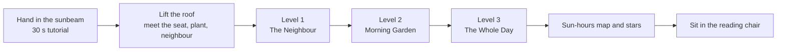
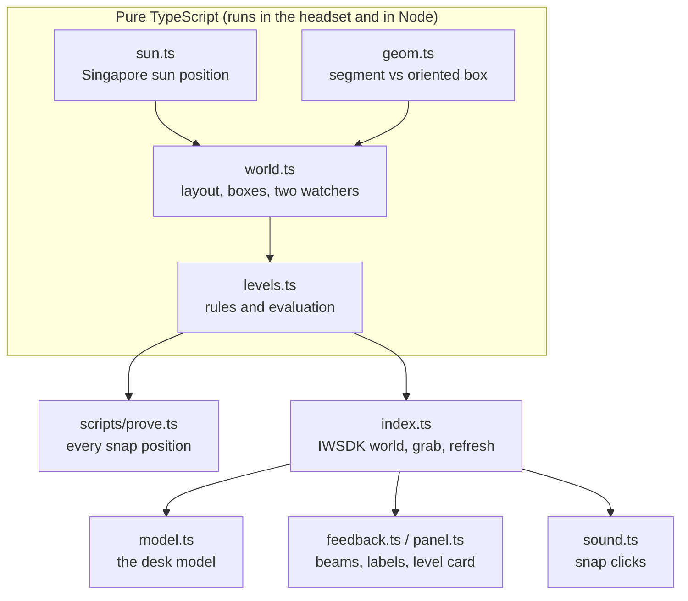

<p align="center">
  
</p>

<p align="center">


</p>

<h3 align="center">Two watchers look at your house: the sun and the neighbour.<br>Let one in. Keep the other out.</h3>

**VaLora: Two Watchers is a seated, hands-only VR puzzle game about designing a house.** A small architectural model of the VaLora courtyard house sits on the desk in front of you. You pinch and swing a privacy screen, slide the roof overhang and drag the sun across the sky until the reading chair is private, the garden gets its morning sun and the chair is shaded in the afternoon. Then you sit in that chair, at full size, and see the room you designed.

> **Status (6 Nov 2026): working prototype.** One screen, one neighbour, one sun and three levels, with the core interaction verified end to end with a simulated hand in Meta's emulator. Everything below marked *planned* is on the [milestone plan](docs/ROADMAP.md).

**In a hurry?** [30-second version](#the-30-second-version) → [competition checklist](#competition-checklist) → [how it plays](#how-it-plays) → [how it works](#how-it-works) → [for judges](#for-judges-try-it-in-two-minutes) → [results](#results) → [documentation](#documentation)

---

## The 30-second version

| | |
|---|---|
| **What** | A short puzzle game played with your hands, seated, in VR. You shape a courtyard house so two watchers see only what they should |
| **The two watchers** | **The Sun** should see some places (the plant in the morning) and not others (the reading chair in the afternoon). **The Neighbour** must never see the reading chair |
| **The idea** | Sunlight and privacy are the same test: *can something see this spot?* The sun is just a watcher very far away. We could not find another game that treats them as one puzzle |
| **What you do** | Pinch and swing the privacy screen, slide the roof overhang in and out, drag the sun across the sky, look through either watcher's eyes, then sit in the chair |
| **Session** | About 5 minutes: hand-in-the-sunbeam tutorial, three levels, the seat view |
| **Platform** | WebXR in Quest Browser, built with Meta's Immersive Web SDK (IWSDK). Designed for Quest 3/3S hands, and for look-and-pinch on Meta VR Glasses |
| **Proof** | Every level is proven solvable by enumerating every snap position (`npm run prove`). A simulated hand completes Level 1 in the IWER emulator (`npm run e2e:hand`) |
| **Honest scope** | Illustrative sunlight and visibility checks, not certified daylight, comfort or privacy analysis |

## Competition checklist

**Hard requirements** ([official requirements](https://start-developer-competition-26.devpost.com/))

| Requirement | Where |
|---|---|
| Built for Meta VR devices, one track | Gaming track. WebXR in Quest Browser on Quest 3/3S |
| Hands-first, end to end, no controller | Every action is a pinch on a large handle; menus are pinchable. Verified with simulated hands in IWER ([TESTING](docs/TESTING.md)); real-headset check on the [Quest checklist](docs/QUEST-TEST-CHECKLIST.md) |
| Policy compliance | No accounts, no data collection, no third-party services ([PRIVACY](docs/PRIVACY.md)) |
| Seated, two-foot radius | A desk-top model within reach; watcher views and the seat view are fixed viewpoints with a fade, no walking |
| Easy in and out, satisfying in under 10 minutes | Opens from a link, about 5 minutes for the whole game, pause and resume at any time |
| Original, not a wrapper | All gameplay, geometry and checks are written here; no external AI or web service |
| Playable build, judge access | Static WebXR build hosted on Vercel (*planned*: stable judge URL) |
| Video under 3 minutes | Recorded from the real build in the emulator (*planned*, [script](docs/VIDEO.md)) |

**Judging criteria** (four, equally weighted)

| Criterion | Evidence |
|---|---|
| Innovation and creativity | "Two watchers": privacy and sunlight as one rule; seeing through the sun's and the neighbour's eyes ([GAME-DESIGN](docs/GAME-DESIGN.md)) |
| Experience design | Hand-in-the-sunbeam onboarding, large snapping handles, cause-and-effect beams, the seat view, comfort-first transitions |
| Technical implementation | One pure geometry engine shared by the game and the solver, solvability proof in CI, emulator hand tests ([ARCHITECTURE](docs/ARCHITECTURE.md)) |
| Polish and presentation | Architectural-model art direction, synthesised sound, 72 fps target on Quest 3 ([PERFORMANCE](docs/PERFORMANCE.md)) |

## How it plays



| Level | Rules | Tools | Solutions |
|---|---|---|---|
| 1 · The Neighbour | Neighbour cannot see the seat | Screen | 3 of 18 positions |
| 2 · Morning Garden | + Sun reaches the plant at 8:30 a.m. | Screen, sun | 1 of 18 |
| 3 · The Whole Day | + Seat in shade at 3:30 p.m. | Screen, overhang, sun | 3 of 90 |

## How it works



Both watchers run the same test: a straight segment from the watcher to the target against oriented boxes (walls, roofs, the screen, the overhang). For the sun, the segment runs from the target towards the sun's direction for the chosen hour. The rendered model is built from the same numbers, so what you see is what is checked. Details in [ARCHITECTURE](docs/ARCHITECTURE.md).

## For judges: try it in two minutes

*Planned once the build is hosted.* Open the judge link in Quest Browser on Quest 3 or 3S, select **Enter VR**, put the controllers down and follow the sunbeam. Controls are in [CONTROLS](docs/CONTROLS.md).

## Results

| Check | Result | How to run |
|---|---|---|
| Levels solvable, none starts solved | 3/3 | `npm run prove` |
| Type check | clean | `npm run typecheck` |
| Simulated hand swings the screen and solves Level 1 (IWER, Quest 3 profile) | pass: −90° → −75° → −60° → −30° → 30°, solved | `npm run e2e:hand` |
| Real Quest 3 hand tracking, comfort, readability, frame rate | not yet tested | [QUEST-TEST-CHECKLIST](docs/QUEST-TEST-CHECKLIST.md) |

Emulator results are reported separately from headset results. The emulator cannot establish real hand-tracking reliability, seated reach, fatigue, stereo readability, comfort or Quest performance.

## Run it

```bash
npm install
npm run dev          # IWSDK dev server with the IWER emulator: https://localhost:8081
npm run prove        # prove every level is solvable
npm run build        # static build in dist/
```

Full setup, emulator controls and deployment: [SETUP](SETUP.md).

## Documentation

| Document | What's in it |
|---|---|
| [GAME-DESIGN](docs/GAME-DESIGN.md) | The two-watchers idea, levels, interactions, feedback, the seat view, what we leave out |
| [ARCHITECTURE](docs/ARCHITECTURE.md) | Modules, the check engine, coordinate systems, scale, the grab-to-angle mapping |
| [TESTING](docs/TESTING.md) | Solvability proof, emulator hand tests, what is and is not tested |
| [QUEST-TEST-CHECKLIST](docs/QUEST-TEST-CHECKLIST.md) | What to verify on a borrowed Quest before submitting |
| [PERFORMANCE](docs/PERFORMANCE.md) | Frame-rate target and budgets for Quest Browser |
| [ACCESSIBILITY](docs/ACCESSIBILITY.md) | Seated, one-handed, not colour alone, comfort |
| [CONTROLS](docs/CONTROLS.md) | Every hand interaction, and the emulator equivalents |
| [COMPETITION](docs/COMPETITION.md) | Rules, judging, division and project history, eligibility questions |
| [BRAND](docs/BRAND.md) | Name, the VaLora story, art direction, type, colour, sound |
| [VIDEO](docs/VIDEO.md) | Demo video plan and recording method |
| [SUBMISSION](docs/SUBMISSION.md) | Draft answers for the Devpost form |
| [ROADMAP](docs/ROADMAP.md) | Milestones to the deadline |
| [PRIVACY](docs/PRIVACY.md) | What the app stores (progress in the browser only) |
| [SETUP](SETUP.md) | Install, emulator, deployment |
| [CREDITS](CREDITS.md) | Third-party software and licences |

## The name

VaLora carries one name inside it: Lora, the wife of its designer, Aljabri Alam. Her initial is the capital L at the heart of the word, and it is the shape of the house: an L of rooms around a garden open to the sky. This game is set in that house.

## License

[MIT](LICENSE). Third-party notices in [CREDITS](CREDITS.md).
