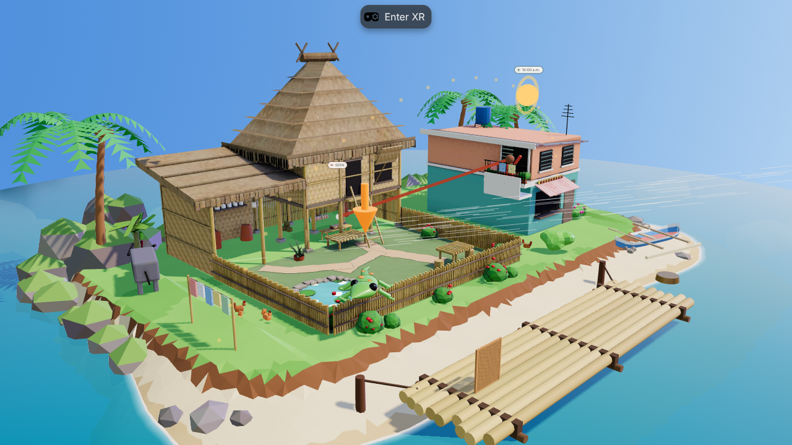
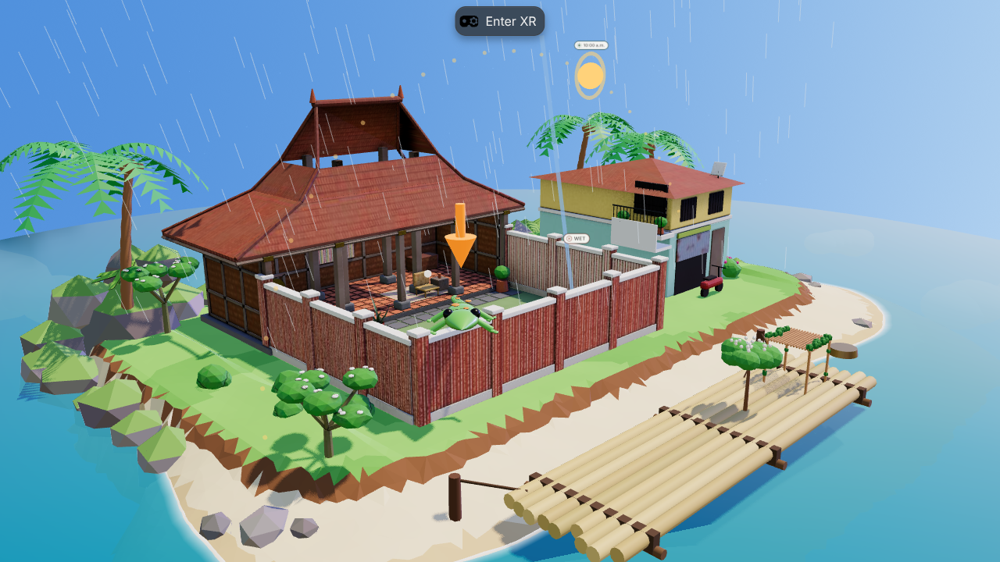
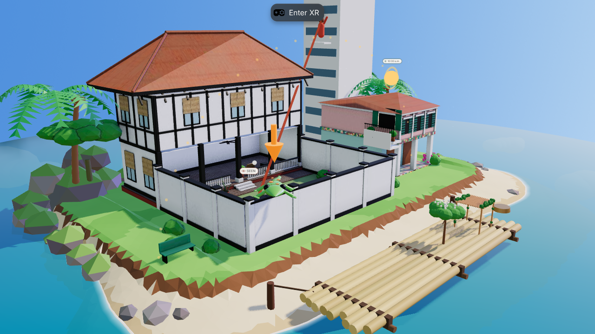
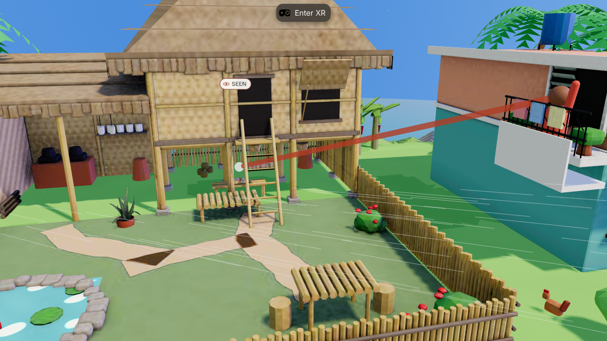
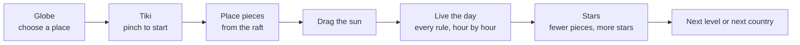
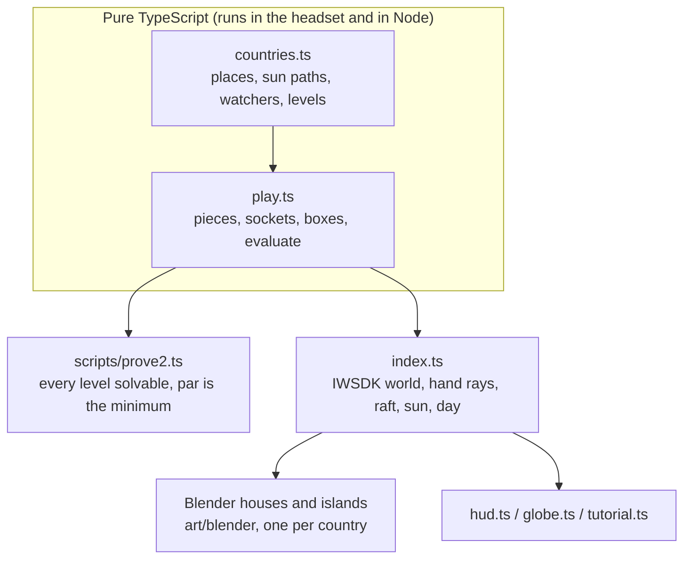

<p align="center">
  
</p>

<p align="center">


</p>

<h3 align="center">Same sun, different skies.<br>Let the sun in, keep the watchers out, across South-east Asia.</h3>

**VaLora: Two Watchers is a seated, hands-only VR puzzle about sun, shade and privacy.** A small island diorama floats in front of you: a house, its courtyard and the neighbours. Pick a country on the globe, then point and pinch pieces from a bamboo raft (screens, hedges, trees, a pergola) onto the courtyard, drag the sun across the sky and live the day, until the sun reaches what it should and no watcher sees what it should not.

> **Status (8 Nov 2026): playable, live at [valora-vr.vercel.app](https://valora-vr.vercel.app).** Four countries with their own houses and twists, 12 levels, Tiki the gecko guide, hands in the headset and mouse on a computer. Hands-only play verified in Meta's IWER emulator; **not yet tested on a real Quest** (planned for 12 Nov).

---

## The 30-second version

| | |
|---|---|
| **What** | A short puzzle game played seated, with your hands, in VR (or with a mouse on a computer) |
| **The watchers** | **The sun** should reach some spots and not others. **A neighbour**, **passing boats** or **a high-rise** must not see the reader. In some places **typhoon wind** or **monsoon rain** must not reach a spot |
| **The idea** | Sunlight, privacy, wind and rain are one test: *can something reach this spot in a straight line?* The sun is just a watcher very far away |
| **Where** | Manila (bahay kubo, typhoon wind), Bangkok (canal house, long-tail boats), Jakarta (joglo, monsoon rain), Singapore (black-and-white bungalow, the high-rise next door). The sun follows each capital's own path for 8 November |
| **How you play** | Choose a place on the globe. Pinch a piece on the raft, point it at the courtyard, let go; pinch it again to turn it. Drag the sun. Press play to live the day; fewer pieces earn more stars |
| **Guide** | **Tiki**, a gecko who sits on the garden wall. Tiki teaches by doing: the tutorial moves on when you place a piece or move the sun |
| **Comfort** | Seated, no walking or turning: the view is set up once when VR starts, and the whole board sits within a short point of your hand |
| **Honest scope** | Illustrative sunlight and visibility checks, not certified daylight, comfort, structural or privacy analysis |

## See it

<table>
<tr>
<td width="50%"><br><sub><b>Manila.</b> A bahay kubo on stilts, the dirty kitchen, a carabao and a banca. The red line is the neighbour's view.</sub></td>
<td width="50%"><br><sub><b>Jakarta.</b> A joglo with its three-pitch roof, red-brick walls and monsoon rain.</sub></td>
</tr>
<tr>
<td width="50%"><br><sub><b>Singapore.</b> A black-and-white bungalow, a Peranakan shophouse and the high-rise watching from above.</sub></td>
<td width="50%"><br><sub><b>Close up.</b> The reader sits on a bench in the shade under the kubo.</sub></td>
</tr>
</table>

## How it plays



| Country | Twist | Levels |
|---|---|---|
| Philippines · Manila | Typhoon wind comes in low over the bamboo fence | Kapitbahay, Umaga, Bagyo |
| Thailand · Bangkok | Long-tail boats pass the garden | Long-tail Boats, Lunch by the Water, A Day on the Water |
| Indonesia · Jakarta | Monsoon rain slants in from the west | Hujan, Rain and Shine, Musim Hujan |
| Singapore | The high-rise next door looks straight down | High-rise, Morning Swim, The Whole Day |

## How it works



Every watcher runs the same test: a straight segment from the watcher (or towards the sun, wind or rain direction) to the target, against boxes for walls, roofs, the neighbour's house and each placed piece. The 3D houses are modelled to stay inside those boxes: tall roofs and upper storeys sit only above the checked roof plane, and courtyard eaves stop where the check's roof stops. Tall plants stand only where their shadows cannot reach the yard.

## For judges: try it in two minutes

Open **[valora-vr.vercel.app](https://valora-vr.vercel.app)** in Quest Browser on Quest 3 or 3S, choose a place on the globe, select **Enter VR**, put the controllers down and pinch Tiki. On a computer, skip Enter VR and play with the mouse: click Continue, drag a piece from the raft, click a placed piece to turn it.

## Results

| Check | Result | How to run |
|---|---|---|
| Every level solvable, none solved at the start, par equals the minimum pieces | 12/12 | `npm run prove` |
| Type check | clean | `npm run typecheck` |
| Hands-only playthrough in the IWER emulator: seated recentre, Tiki pinch, carry a raft piece by pointing, turn it, solve Manila level 1, drag the sun, press play | 11/11 checks pass | `npm run e2e:play` |
| Mouse playthrough on a computer: Manila level 1 solved with 3 stars, day completes | pass | browser test |
| Real Quest 3 hand tracking, comfort, readability, frame rate | **not yet tested** | [QUEST-TEST-CHECKLIST](docs/QUEST-TEST-CHECKLIST.md) |

Emulator results are reported separately from headset results. The emulator cannot establish real hand-tracking reliability, seated reach, fatigue, stereo readability, comfort or Quest performance.

## Run it

```bash
npm install
npm run dev          # IWSDK dev server with the IWER emulator: https://localhost:8081
npm run prove        # prove every level is solvable
npm run build        # static build in dist/
```

Art is generated in Blender from code: `python3 art/blender/stitch.py ph && blender-python art/blender/house_ph.py`, and `VALORA_COUNTRY=ph blender-python art/blender/island2.py`. The showcase video is rendered frame by frame from the game: `scripts/video/run-all.sh`, `scripts/video/make-titles.sh`, `python3 scripts/video/music.py video/music.wav`, `python3 scripts/video/edit.py`.

## Documentation

| Document | What's in it |
|---|---|
| [GAME-DESIGN](docs/GAME-DESIGN.md) | The two-watchers idea, levels, interactions, feedback, the seat view, what we leave out |
| [ARCHITECTURE](docs/ARCHITECTURE.md) | Modules, the check engine, coordinate systems, scale, the grab-to-angle mapping |
| [TESTING](docs/TESTING.md) | Solvability proof, emulator hand tests, what is and is not tested |
| [QUEST-TEST-CHECKLIST](docs/QUEST-TEST-CHECKLIST.md) | What to verify on a borrowed Quest before submitting |
| [PERFORMANCE](docs/PERFORMANCE.md) | Frame-rate target and budgets for Quest Browser |
| [ACCESSIBILITY](docs/ACCESSIBILITY.md) | Seated, one-handed, not colour alone, comfort |
| [CONTROLS](docs/CONTROLS.md) | Every hand interaction, and the emulator equivalents |
| [COMPETITION](docs/COMPETITION.md) | Rules, judging, division and project history, eligibility questions |
| [BRAND](docs/BRAND.md) | Name, the VaLora story, art direction, type, colour, sound |
| [VIDEO](docs/VIDEO.md) | Demo video plan and recording method |
| [SUBMISSION](docs/SUBMISSION.md) | Draft answers for the Devpost form |
| [ROADMAP](docs/ROADMAP.md) | Milestones to the deadline |
| [PRIVACY](docs/PRIVACY.md) | What the app stores (progress in the browser only) |
| [SETUP](SETUP.md) | Install, emulator, deployment |
| [CREDITS](CREDITS.md) | Third-party software and licences |

## The name

VaLora carries one name inside it: Lora, the wife of its designer, Aljabri Alam. Her initial is the capital L at the heart of the word, and it is the shape of the house: an L of rooms around a garden open to the sky. This game is set in that house.

## License

[MIT](LICENSE). Third-party notices in [CREDITS](CREDITS.md).
