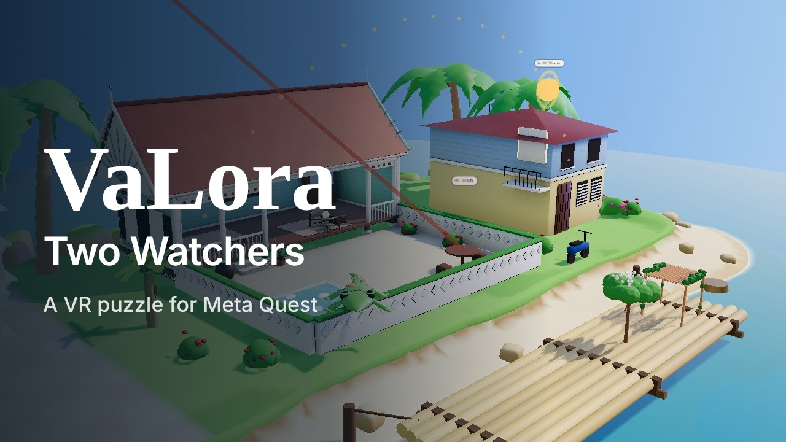
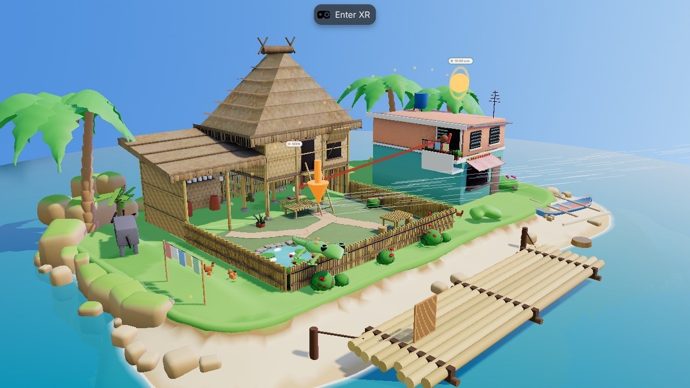
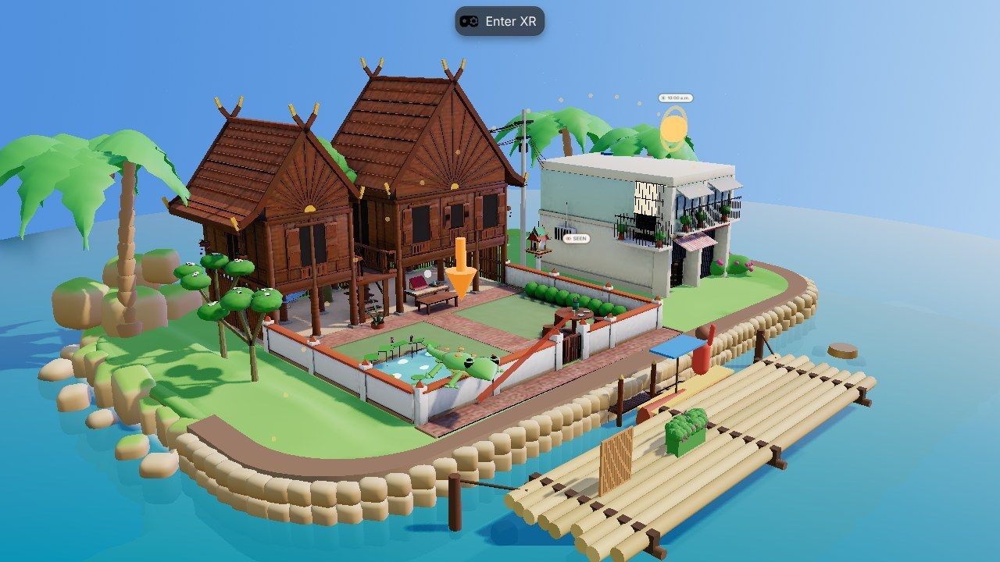
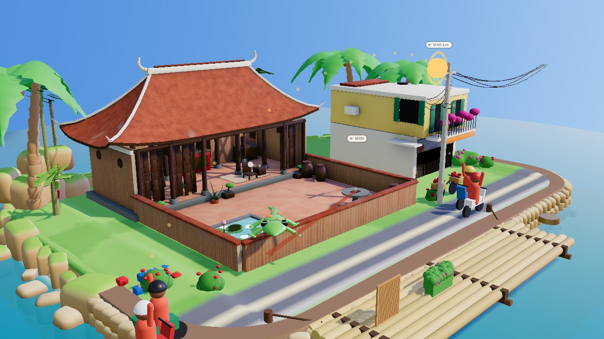
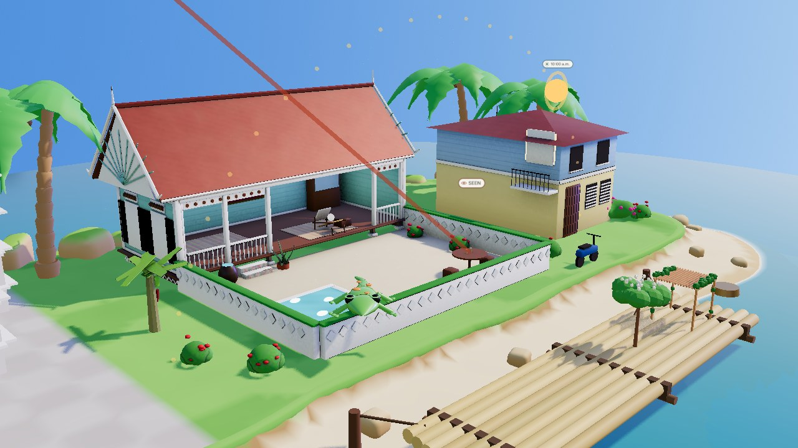
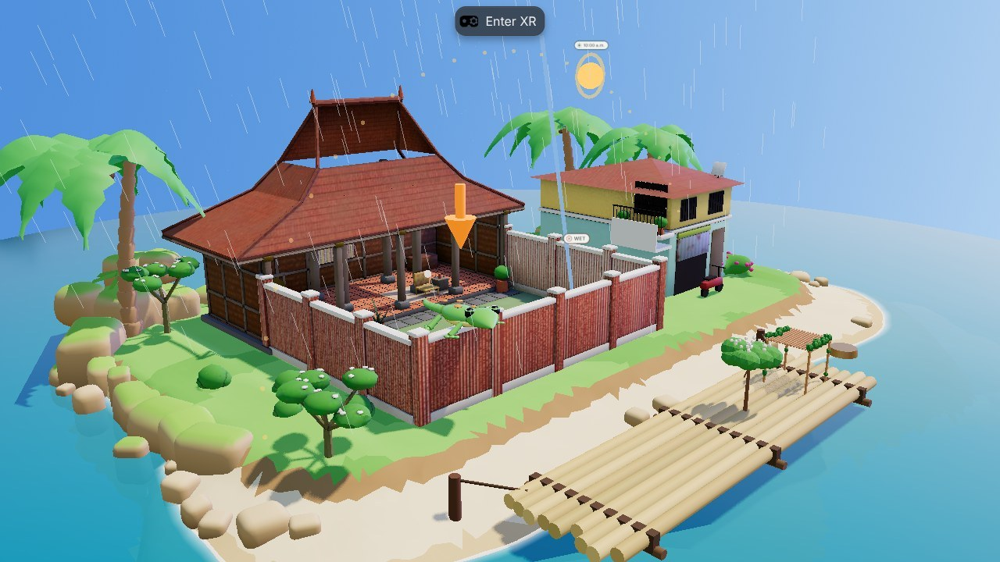
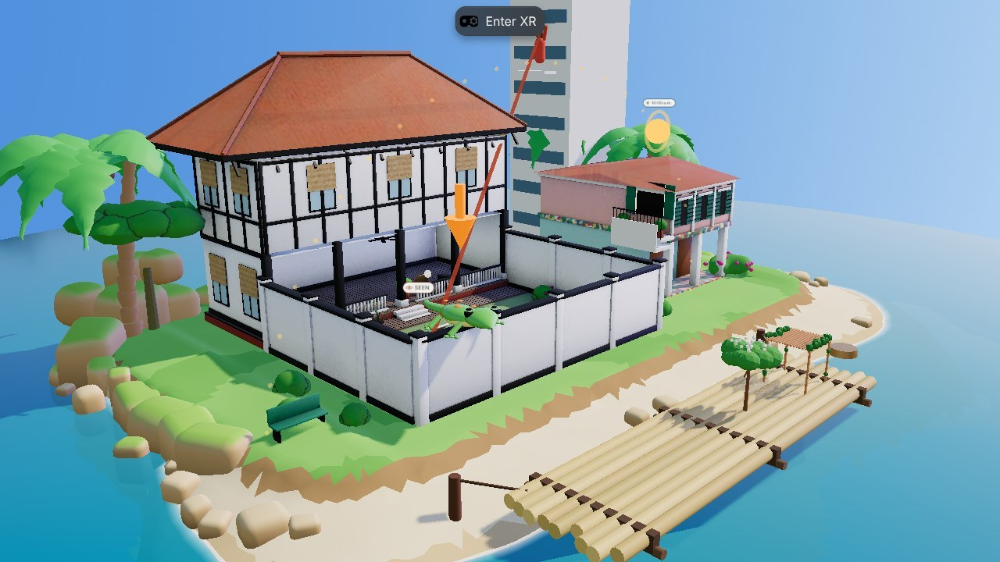
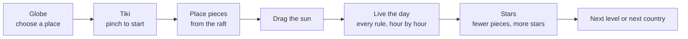
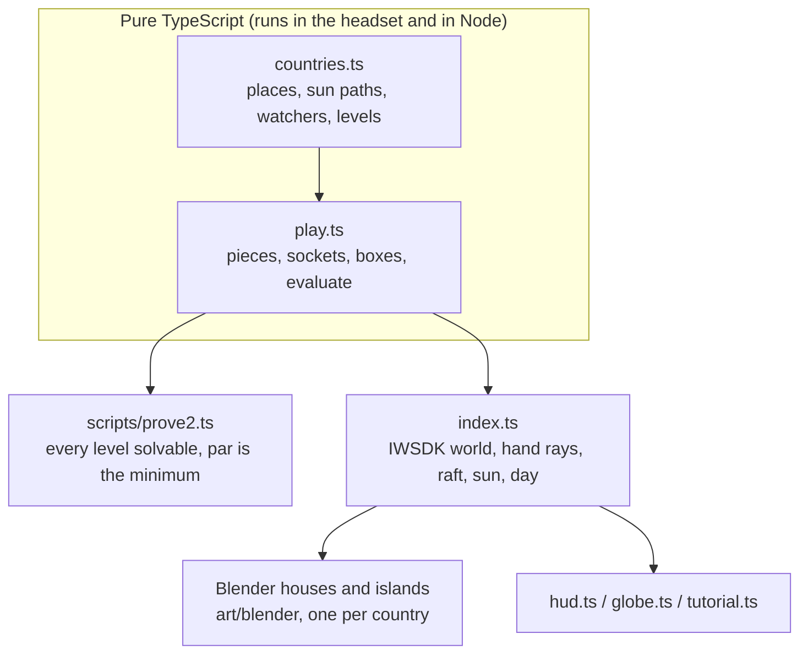

<p align="center">
  
</p>

<p align="center">


</p>

<p align="center">
<a href="https://youtu.be/BQlZkN5x4PU"></a>
<a href="https://valora-vr.vercel.app"></a>
</p>

<h3 align="center">Same sun, different skies.<br>Let the sun in, keep the watchers out, across South-east Asia.</h3>

**VaLora: Two Watchers is a seated, single-player VR puzzle about sun, shade and privacy, played with your hands (Touch controllers work too).** The two watchers are the sun and whoever looks in; it is not a two-player game. A small island diorama floats in front of you: a house, its courtyard and the neighbours. Pick a country on the globe, then point and pinch pieces from a bamboo raft (screens, hedges, trees, a pergola) onto the courtyard, drag the sun across the sky and live the day, until the sun reaches what it should and no watcher sees what it should not.

<p align="center">
<a href="https://youtu.be/BQlZkN5x4PU"></a><br>
<sub><b><a href="https://youtu.be/BQlZkN5x4PU">Watch the demo on YouTube</a></b> (2:40): the trailer, choosing a place, how to play with hands and Touch controllers, how to score, and all six capitals.</sub>
</p>

> **Status (11 Nov 2026): playable, live at [valora-vr.vercel.app](https://valora-vr.vercel.app).** Six countries with their own houses and twists, 18 levels, Tiki the gecko guide, hands in the headset and mouse on a computer. Hand and controller play verified in Meta's IWER emulator; **not yet tested on a real Quest** (planned for 12 Nov).

---

## The 30-second version

| | |
|---|---|
| **What** | A short puzzle game played seated, with your hands, in VR (or with a mouse on a computer) |
| **The watchers** | **The sun** should reach some spots and not others. **A neighbour**, **passing boats**, **motorbikes in the lane**, **condo towers** or **a high-rise** must not see the reader. In some places **typhoon wind** or **monsoon rain** must not reach a spot |
| **The idea** | Sunlight, privacy, wind and rain are one test: *can something reach this spot in a straight line?* The sun is just a watcher very far away |
| **Where** | Manila (bahay kubo, typhoon wind), Bangkok (teak ruen thai on a canal, long-tail boats), Hanoi (northern village house on a lakeside lane, motorbikes), Kuala Lumpur (Malay kampung house on stilts, condo towers), Jakarta (joglo, monsoon rain), Singapore (black-and-white bungalow, the high-rise next door). The sun follows each capital's own path for 8 November |
| **How you play** | Choose a place on the globe. Pinch a piece on the raft, point it at the courtyard, let go; pinch it again to turn it (with Touch controllers, the trigger does the pinch). Drag the sun. Press play to live the day |
| **How you score** | Each level has a few rules on the level card, each NOT YET until it holds. When every rule is DONE the level is solved; par or fewer pieces earns three stars, shown on the card as stars and "pieces · par" |
| **Players** | One. The two watchers are the sun and whoever looks in |
| **Guide** | **Tiki**, a gecko who sits on the garden wall. Tiki teaches by doing: the tutorial moves on when you place a piece or move the sun. In the headset Tiki's words sit beside the level card at the back of the desk, so they never cover the courtyard |
| **Comfort** | Seated, no walking or turning: the view is set up once when VR starts, and the whole board sits within a short point of your hand |
| **Honest scope** | Illustrative sunlight and visibility checks, not certified daylight, comfort, structural or privacy analysis |

## Inspiration

The game grew out of **[VaLora](https://valora-seven-beryl.vercel.app/)**, a concept courtyard house in Singapore, presented there as a live 3D model with floor plans, materials and a sun study of the courtyard. Designing that house meant working out where the sun reaches the courtyard through the day and what the neighbours can see. Those turned out to be the same question: a spot is in sun when the sun can see it, and a chair is private when the neighbour cannot. The sun is just a watcher very far away. VaLora: Two Watchers turns that question into a puzzle, then takes it around Southeast Asia, where every city has its own sun, its own houses and its own watchers.

## See it

<table>
<tr>
<td width="50%"><br><sub><b>Manila.</b> A bahay kubo on stilts, the dirty kitchen, a carabao and a banca pulled up on the beach. Typhoon wind streaks in over the bamboo fence.</sub></td>
<td width="50%"><br><sub><b>Bangkok.</b> A teak ruen thai on posts with an open terrace, a spirit house, a stone canal wall and a water landing. Long-tail boats pass on the khlong.</sub></td>
</tr>
<tr>
<td width="50%"><br><sub><b>Hanoi.</b> A northern village house with laterite walls, lim-wood columns and a curved fish-scale tile roof, an ancestral altar, a lotus pond and chum rain jars. Motorbikes stream down the lane outside, past a flower seller's bicycle and a tangle of power lines.</sub></td>
<td width="50%"><br><sub><b>Kuala Lumpur.</b> A Malay kampung house on stilts with mint plank walls, a red zinc roof and a sunburst gable, hibiscus in the yard. Condo towers rise next door and look straight down.</sub></td>
</tr>
<tr>
<td width="50%"><br><sub><b>Jakarta.</b> A joglo with its three-pitch roof, red-brick walls and monsoon rain slanting in from the west.</sub></td>
<td width="50%"><br><sub><b>Singapore.</b> A black-and-white bungalow, a Peranakan shophouse, and the high-rise watching the pool from above.</sub></td>
</tr>
</table>

Each island is a small storybook diorama: a base of round, moss-capped rocks, a lawn that rolls softly over onto the sand, palms with ringed trunks and broad fronds, and a house modelled after the country's own vernacular. [ART](docs/ART.md) explains how the art is made and why it never disagrees with the checks.

## How it plays



| Country | Twist | Levels |
|---|---|---|
| Philippines · Manila | Typhoon wind comes in low over the bamboo fence | Kapitbahay, Umaga, Bagyo |
| Thailand · Bangkok | Long-tail boats pass on the canal | Long-tail Boats, Lunch by the Water, A Day on the Water |
| Vietnam · Hanoi | Motorbikes stream down the lane, riders glancing over a low wall | Xe Máy, Hàng Xóm, Một Ngày Hà Nội |
| Malaysia · Kuala Lumpur | Condo towers rise over the kampung and look straight down | Kampung Baru, Teh Tarik, Sehari Suntuk |
| Indonesia · Jakarta | Monsoon rain slants in from the west | Hujan, Rain and Shine, Musim Hujan |
| Singapore | The high-rise next door looks straight down | High-rise, Morning Swim, The Whole Day |

## How it works



Every watcher runs the same test: a straight segment from the watcher (or towards the sun, wind or rain direction) to the target, against boxes for walls, roofs, the neighbour's house and each placed piece. The 3D houses are modelled to stay inside those boxes, so what you see is what is checked: tall roofs and upper storeys sit only above the checked roof plane, courtyard eaves stop where the check's roof stops, no post stands where the reader's sun or the neighbour's line of sight crosses the open face of the house, and tall plants or poles stand only where their shadows cannot reach the yard. Details in [ARCHITECTURE](docs/ARCHITECTURE.md) and [ART](docs/ART.md).

## For judges: try it in two minutes

Open **[valora-vr.vercel.app](https://valora-vr.vercel.app)** in Quest Browser on Quest 3 or 3S, choose a place on the globe, select **Enter VR**, put the controllers down (or keep them: point and pull the trigger) and pinch Tiki. On a computer, skip Enter VR and play with the mouse: click Continue, drag a piece from the raft, click a placed piece to turn it.

## Results

| Check | Result | How to run |
|---|---|---|
| Every level solvable, none solved at the start, par equals the minimum pieces | 18/18 | `npm run prove` |
| Type check | clean | `npm run typecheck` |
| Hands playthrough in the IWER emulator: seated recentre, Tiki pinch, carry a raft piece by pointing, turn it, solve Manila level 1, drag the sun, press play, no console errors | 11/11 checks pass (re-run 11 Nov after moving Tiki's words) | `npm run e2e:play` |
| Touch controller play in the IWER emulator: Hanoi level 1 solved with the trigger | pass (filmed for the demo) | `INPUT=controller node scripts/video/vrshots.mjs v_vn` |
| Mouse playthrough on a computer: Manila level 1 solved with 3 stars, day completes | pass | browser test |
| Real Quest 3 hand tracking, comfort, readability, frame rate | **not yet tested** | [QUEST-TEST-CHECKLIST](docs/QUEST-TEST-CHECKLIST.md) |

Emulator results are reported separately from headset results. The emulator cannot establish real hand-tracking reliability, seated reach, fatigue, stereo readability, comfort or Quest performance.

## Run it

```bash
npm install
npm run dev          # IWSDK dev server with the IWER emulator: https://localhost:8081
npm run prove        # prove every level is solvable
npm run build        # static build in dist/
```

Art is generated in Blender from code (no hand-made model files). With `blender-python` being Blender's Python or Python with the `bpy` package:

```bash
python3 art/blender/stitch.py th && blender-python art/blender/house_th.py    # house + baked textures
VALORA_COUNTRY=th blender-python art/blender/island2.py                      # island, rocks, lip, foam
blender-python art/blender/trees.py                                          # palms and shrubs
```

Use `ph`, `th`, `vn`, `my`, `id` or `sg`. Social graphics: [SOCIAL](docs/SOCIAL.md).

## Demo video

**[Watch it on YouTube](https://youtu.be/BQlZkN5x4PU)**. The submission demo is 2:40, narrated, inside the 3-minute limit: a trailer, our entry card, the goal, choosing a place on the globe, then the game in the headset view (Meta's IWER emulator, labelled on every shot) with hands and with Touch controllers, how scoring works, one twist per capital, the proof and the maker. It is rendered frame by frame from the game; the narration is a synthetic voice made locally with Kokoro (open weights). Shot list, timeline and commands: [VIDEO](docs/VIDEO.md).

## Documentation

| Document | What's in it |
|---|---|
| [GAME-DESIGN](docs/GAME-DESIGN.md) | The two-watchers idea, levels, interactions, feedback, the seat view, what we leave out |
| [ARCHITECTURE](docs/ARCHITECTURE.md) | Modules, the check engine, coordinate systems, scale, the grab-to-angle mapping |
| [TESTING](docs/TESTING.md) | Solvability proof, emulator hand tests, what is and is not tested |
| [QUEST-TEST-CHECKLIST](docs/QUEST-TEST-CHECKLIST.md) | What to verify on a borrowed Quest before submitting |
| [PERFORMANCE](docs/PERFORMANCE.md) | Frame-rate target and budgets for Quest Browser |
| [ACCESSIBILITY](docs/ACCESSIBILITY.md) | Seated, one-handed, not colour alone, comfort |
| [CONTROLS](docs/CONTROLS.md) | Every hand interaction, and the emulator equivalents |
| [COMPETITION](docs/COMPETITION.md) | Rules, judging, division and project history, eligibility questions |
| [ART](docs/ART.md) | The storybook diorama look, each country's island, the Blender pipeline, the rule that art never contradicts the checks |
| [BRAND](docs/BRAND.md) | Name, the VaLora story, type, colour, sound |
| [VIDEO](docs/VIDEO.md) | The 2:40 demo, trailer and showcase: shot lists, voice-over, the frame-exact capture pipeline |
| [SOCIAL](docs/SOCIAL.md) | Ten ready-to-post graphics (square, 4:5 carousel, story, landscape, the competition entry) and how they are made |
| [SUBMISSION](docs/SUBMISSION.md) | Draft answers for the Devpost form |
| [ROADMAP](docs/ROADMAP.md) | Milestones to the deadline |
| [PRIVACY](docs/PRIVACY.md) | What the app stores (progress in the browser only) |
| [SETUP](SETUP.md) | Install, emulator, deployment |
| [CREDITS](CREDITS.md) | Third-party software and licences |

## The name

VaLora carries one name inside it: Lora, the wife of its designer, Aljabri Alam. Her initial is the capital L at the heart of the word, and it is the shape of the house: an L of rooms around a garden open to the sky. This game is set in that house.

## License

[MIT](LICENSE). Third-party notices in [CREDITS](CREDITS.md).
