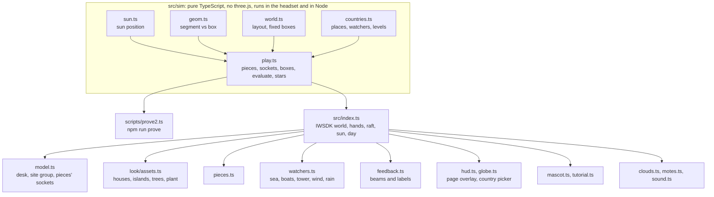

# Architecture

## 1. Overview

The game is a static WebXR page. IWSDK (`@iwsdk/core`, the Immersive Web SDK) owns the renderer, the XR session (the immersive VR mode), hand input and the emulator hookup. Everything that decides whether a rule passes lives in `src/sim`, which imports nothing from three.js or the browser, so the same code runs in the headset and in Node for the solvability proof.

## 2. Coordinates and scale

| Space | Units and axes | Where |
|---|---|---|
| **Site** | Real metres. +x east, −z north, +y up. Courtyard x −5..5, z −3..4; the room north of it, z −7..−3; the neighbour's house east, x 8.1..12.3 | `src/sim`, Blender scripts, all art |
| **Desk** | The site group scaled 1:18 on a desk top at y 0.75 m; site origin at about world (−0.18, 0.75, −0.48) | `src/model.ts` (`SCALE`, `DESK`) |
| **World** | IWSDK's origin. In VR the player rig is moved once so the seated head is at the desk (see 5.4) | `src/index.ts` |

`siteToWorld(p)` converts site points to world points through the site group's matrix. Blender's own axes are z up, so the scripts convert with `P(x, y, z) → (x, −z, y)`.

## 3. The check engine

`geom.ts` tests a straight segment against a box (optionally rotated about the vertical) with the slab method and returns where it enters. `play.ts` builds the boxes from the fixed house (`world.ts`: walls, roof plane, garden walls at each country's height, the neighbour's house) plus every placed piece, then answers one question for every rule: *can this watcher reach this target in a straight line?*

| Watcher | Segment | Countries |
|---|---|---|
| Sun | From the target 60 m along the sun's direction at the rule's hour | All |
| Neighbour's window | From the window to the target | All |
| Boats | From each passing boat's eye height to the target; blind only if every boat is blocked | Thailand |
| High-rise | From the tower's balcony to the target | Singapore |
| Wind | From the target into the typhoon wind's direction, low over the fence | Philippines |
| Rain | From the target up into the slanting rain | Indonesia |

Targets are the reader's seat, the plant, the pool, the garden table and the deck. A rule wants a watcher to *see* (sun on the plant) or be *blind* (no neighbour on the seat). `evaluateLevel` returns each rule's pass or fail, the first blocker and where it was hit (which sets the beam length), whether the level is solved, and its stars: par or fewer pieces earns 3, one more earns 2, otherwise 1.

### Pieces and sockets

| Piece | Blocks | Turns |
|---|---|---|
| Screen | Eyes and low sun | 4 |
| Hedge | Low views only | 2 |
| Tree | High sun and views from above, not eye level | 1 |
| Pergola | Midday sun | 1 |

Pieces stand on a grid of sockets over the courtyard (skipping the pool and the plant). Some levels also let the player slide out the roof overhang. The 3D pieces in `pieces.ts` are built from the same footprints and heights the checks use.

## 4. Sun position

`sun.ts` computes elevation, azimuth and a unit direction from hour angle, declination and latitude. `countries.ts` gives each capital its latitude and its clock time of solar noon on 8 November (longitude, time zone and the equation of time), so Manila, Bangkok, Jakarta and Singapore each have their own sun path. The rendered sun light follows the same function.

## 5. Interaction

### 5.1 Hand rays

Every action is a ray pinch (aim and pinch), which works with Quest hand tracking and with controllers. The game reads the rays from `world.player.raySpaces` (left and right) and moves held things itself: a held piece follows where the hand ray meets the desk plane, keeping the offset from where it was picked up; the sun follows the hour whose point on the arc is nearest the ray. `DistanceGrabbable` is used with `translate: false` only to get pinch events.

### 5.2 Hit boxes

Thin parts (raft slats, a hedge's foliage) are hard to hit with a ray, so every piece, the sun handle, Tiki and the play button carries an invisible box (`HIT_MAT`, colour writes off) that takes the ray. Scenery (houses, islands, trees, clouds, labels) never takes rays, so nothing gets between the hand and a target.

### 5.3 Place, turn, play

- Pinch a piece on the bamboo raft, point at the courtyard, let go: it snaps to the nearest free socket.
- Pinch a placed piece and let go without moving it more than 2 cm: it turns to its next angle. This is judged on movement only, never time, because the emulator runs far slower than real time.
- Drag the sun along its arc to try any hour; press play to live the day, every rule checked hour by hour.

### 5.4 Seated recentre

Thirty XR frames after the session starts, the rig is moved so the head sits at `SEAT_HEAD` in front of the desk (read from `world.player.head`). The view switches between flat and headset layouts per frame, from `renderer.xr.isPresenting`, because session events can fire before presenting starts. In the IWER emulator (`window.IWER_DEVICE` present; the emulator reports a Quest user agent, so the agent string is not used) the same path runs.

## 6. Rendering

- One directional light is the sun, with a 2048 shadow map fitted to the island. A hemisphere light gives sky fill and warm bounce. The dome gradient and image-based light are set in `public/scenes/main.iwsdk.scene.json` (ACES tone mapping).
- Houses, islands and trees are glTF files made by script in Blender ([ART](ART.md)): baked colour and occlusion atlases for houses, vertex colours for islands and trees, smooth normals with crisp edges.
- A country with its own house hides the code-drawn ghost roof and glass; Thailand also hides the code-drawn balcony because its neighbour's house models one.
- Code keeps what moves, glows or is see-through: the sea, the pool water, pieces, beams and labels, the sun handle, boats, rain, wind, clouds, dust motes and Tiki.
- Labels and Tiki's speech are canvas textures with tone mapping off so text stays crisp. On a computer the same words appear in a page overlay (`hud.ts`) at reading size.

## 7. Build and hosting

Vite with `@iwsdk/vite-plugin-dev` for development (HTTPS, IWER emulator injection). `npm run build` writes a static site to `dist/`, deployed to Vercel at [valora-vr.vercel.app](https://valora-vr.vercel.app). No server code; best stars are kept in the browser's local storage.

URL parameters: `?country=ph|th|id|sg&level=1..3`.

## 8. Test hooks

`window.VR` exposes hooks for scripted tests and video capture:

| Hook | Use |
|---|---|
| `state()`, `stats()` | Current design and level; renderer statistics |
| `setCountry`, `setLevel`, `place`, `setHour`, `live` | Drive the game without input |
| `tapTiki()` | Continue the tutorial |
| `pieceWorld`, `socketWorld`, `worldPos`, `worldToScreen`, `pieceScreen`, `socketScreen`, `siteToScreen` | Positions for aiming emulated hands or a mouse |
| `pieceBox`, `boxOf`, `rayHits` | What a ray hits |
| `rig`, `recentreNow`, `tilt`, `toRig` | The seated rig, for emulator tests and capture |
| `cinema`, `chrome` | A fixed camera and hidden overlays for video shots |

The app logs `[VR] design … solved … stars …`, `[VR] step …`, `[VR] view …`, `[VR] recentre …`, `[VR] release`, `[VR] sun grab` and `[VR] day start`, which the emulator test reads. `window.__capture` (set only by the video scripts) turns off emulator-only behaviour for capture.
