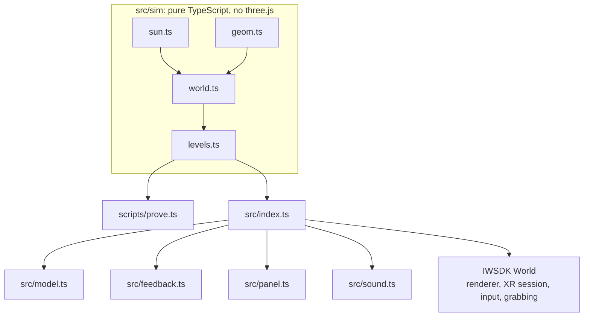
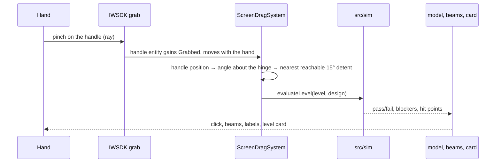

# Architecture

## 1. Overview



The game is a static WebXR page. IWSDK (`@iwsdk/core`) owns the renderer, the XR session, hand and controller input and grabbing. Everything that decides whether a rule passes lives in `src/sim`, which imports nothing from three.js or the browser, so the identical code runs in the headset and in Node for the solvability proof.

## 2. Coordinates and scale

- **Site space** (`src/sim`): real metres. +x east, −z north, +y up, matching the VaLora website's `spec.js`. The courtyard spans x −5..5, z −3..4; the living room is north of it (z −7..−3) with glass on its south face.
- **Desk space** (`src/model.ts`): the site is scaled 1:25 and centred on a desk at 0.74 m height, 0.52 m in front of the player. *Planned:* larger scale (about 1:16) so detents are further apart for real hands.
- **World space**: IWSDK's XR origin. Seated players are placed by the `local-floor` reference space.

## 3. The check engine

`geom.ts` tests a straight segment against an oriented box (a box rotated about the vertical axis) with the slab method, returning where the segment enters. `world.ts` builds the boxes from the current `Design` (screen angle, overhang depth) plus the fixed walls and roofs, and answers two questions:

```ts
neighbourSees(target, design)      // segment: neighbour's window → target
sunSees(target, design, sunAt(h))  // segment: target → 60 m along the sun's direction
```

Each answer carries the first blocker and where along the line it was hit, which drives the beam length and the "blocked by the privacy screen" text. `levels.ts` turns rules (watcher, target, want sees or blind, hour) into pass or fail.



## 4. Sun position

`sun.ts` is a port of the website's `sunAt()`: hour angle, declination (−16.1° for 6 November), latitude 1.35°, solar noon at 12:49. It returns elevation, azimuth and a unit direction. `declination(dayOfYear)` is included for the planned daily challenge.

## 5. Interaction

The handle is its own entity at world level with `RayInteractable` and `DistanceGrabbable` in `MoveAtSource` mode: the handle moves with the hand. `ScreenDragSystem` reads the handle's position each frame, converts it to an angle about the screen's hinge in site space, and snaps to the nearest angle the screen can physically reach (`screenAngles()`). The screen eases to that angle with a critically damped spring. When released, the handle returns to the screen's free end.

A ray pinch is used deliberately: it works with Quest hand tracking, with controllers, and with look-and-pinch on Meta VR Glasses.

## 6. Rendering

- One directional light is the sun, with a 2048 shadow map fitted to the model.
- The dome and image-based light are IWSDK gradient components set in the scene file.
- Beams are thin open cylinders; labels and the level card are canvas textures with tone mapping off, so text stays crisp.
- Materials are matte basswood, card and teak to read as an architect's model.

## 7. Build and hosting

Vite with `@iwsdk/vite-plugin-dev` for development (HTTPS, IWER emulator injection). `npm run build` writes a static site to `dist/`, deployed to Vercel. No server code.

## 8. Test hooks

`window.VR` exposes `setDesign`, `setLevel`, `state`, `handleScreen` and `worldToScreen` for scripted screenshots and checks. The app logs `[VR] design … solved …` on every change, which the emulator test reads.
