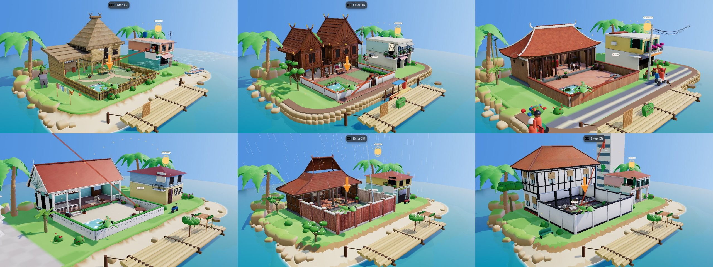
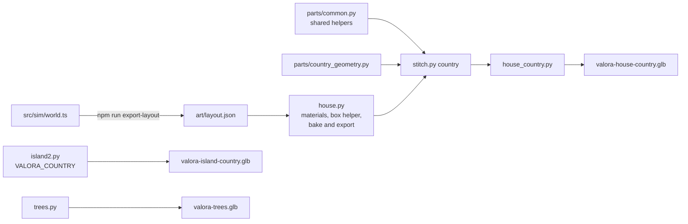

# Art

## 1. Direction: a bright storybook diorama

Each country is a small island floating on turquoise water in front of you, like a hand-made model on a desk. The references are stylised tropical island dioramas: soft, rounded shapes, warm sandstone rocks with moss on top, broad drooping palm fronds, clean colour gradients and bright daylight.

| Choice | Why |
|---|---|
| Rounded rocks, soft bevels, smooth shading | Reads as friendly and hand-made at arm's length; no sharp facets to shimmer in the headset |
| Bright daylight, no dark backdrop | The game is about the sun; the light must feel like a sunny day in each capital |
| Real vernacular houses | Each island is recognisably its country, built from that country's own materials |
| Colour in gradients, not hard bands | Grass, sand and rock blend into each other; no sawtooth edges from the terrain grid |
| Everything generated by script | Repeatable, small and editable; no imported model files |

## 2. The rule: art never contradicts the checks

The watchers do not look at the 3D models. They test straight lines against boxes in `src/sim` (see [ARCHITECTURE](ARCHITECTURE.md)). So the art must never show something the checks do not know about, or hide something the checks treat as open. What you see is what is checked.

| Constraint | How the art keeps it |
|---|---|
| The house's north, west and east sides are solid to 3 m; the courtyard face is open | Walls, slat screens and lattice fill those sides; the courtyard face stays open below the floor |
| A roof plane at 3 m covers the room | Tall roofs, upper storeys and raised floors sit where the sun's rays to the reader cannot reach them. In Manila and Bangkok the November noon sun is about 60° high, so every ray to the reader crosses the open face below 2.0 m and a floor at 2.0 m shades nothing the checks let through |
| Courtyard eaves stop where the check's roof stops | Gables and eaves on the courtyard side end at z −2.9 |
| The reader's sun and the neighbour's line of sight cross the open face between x 0 and 3.3 | No post stands on the open face there |
| Garden walls have each country's height (Manila 1.0 m, Bangkok 0.9 m, Hanoi 1.1 m, Kuala Lumpur 1.0 m, Jakarta and Singapore 2.2 m) | Walls and fences are built to that height; anything near a wall stays inside its shadow |
| The neighbour's house fits its box below 4.6 m | Every neighbour is modelled inside the box, with a balcony where the watching figure stands |
| Tall things outside the yard | Placed only where their shadow can never reach a target: in November the sun is always south of east–west, so anything north of the targets is safe. The Bangkok spirit house and power pole stand outside the north-east corner; plumerias and bananas stand west and north |

Placed pieces (screens, hedges, trees, pergolas) are built in code from the same boxes the checks use.

## 3. The islands

| Country | House | Garden | Around the house | Neighbour |
|---|---|---|---|---|
| Philippines · Manila | Bahay kubo on bamboo stilts, nipa roof, sawali walls; the reader on a bench in the shade under the house; a dirty-kitchen annex | Bamboo fence, fish pond, papag daybed, gumamela | Carabao, hens, laundry line, banca on the beach | Two-tone concrete house with a sari-sari store |
| Thailand · Bangkok | Teak ruen thai: two pavilions on round posts with steep tile roofs, crossed kalae tips and sunburst gables, an open terrace with a tree growing through it; the reader on a teak daybed with a triangular cushion under the house | Whitewashed wall with terracotta coping, brick paving, lotus pond and glazed lotus jars, teak table with a food carrier | Spirit house, plumerias, a power pole with tangled wires, a stone-block canal wall, a water landing and a moored rowing boat | Shophouse with folding steel shutters, a balcony and a burglar grille |
| Vietnam · Hanoi | Northern village house (nhà ba gian, after Đường Lâm): laterite walls, dark lim-wood columns on bluestone bases, folding panel doors pushed back, an ancestral altar with a lacquered board, a curved fish-scale tile hip roof with lifted corners and a moulded ridge with curled ends | Laterite wall (1.1 m) with tiled coping, Bát Tràng terracotta yard tiles, a lotus pond, chum rain jars, a stone tea table, bonsai | A lakeside lane with a stone embankment where the motorbikes run (riders drawn in code), a flower seller's bicycle, a street tea stall with plastic stools, a power pole and its tangle, areca palms and bamboo | Hanoi tube house: shop with a rolling shutter, French shutters, a balcony with bougainvillea |
| Malaysia · Kuala Lumpur | Malay kampung house (rumah Melayu) on short timber stilts with a lattice skirt, mint plank walls with white trim, tall louvred windows under fretwork vents, an open serambi with turned balusters, tiled front steps, a long red zinc gable roof with sunburst tebar layar and curled barge boards; the reader in a kerusi malas | White wall (1.0 m) with a relief band and green coping, swept sand, a tiled pool, hibiscus (bunga raya) and pandan, a tempayan jar | A paved plaza under the condo towers (built in code), a parked kapcai, bananas, a rambutan tree | Two-storey kampung house: concrete below, blue timber above, a zinc hip roof |
| Indonesia · Jakarta | Javanese joglo: carved teak gebyok walls, teak columns on umpak stone bases, the three-pitch roof in terracotta genteng tiles with a mustaka finial | Exposed red-brick walls with plaster copings, andesite paving, a kolam fish pond, kamboja (frangipani), a gong | A parked scooter, lanterns | Two-storey house with a small shop and a decorative window grille |
| Singapore | Black-and-white bungalow with a verandah | Lawn, tiled pool, loungers, wrought-iron table | Rain trees, a park bench | Peranakan shophouse; the high-rise is built in code |

Every island shares the base: a ring of round sandstone rocks with moss caps (two rows, the outer one lower and wet at the waterline), a smooth grass lip where the lawn rolls over onto sand, a beach with a foam line (a built stone embankment in Bangkok and Hanoi), and palms with ringed, curving trunks.

## 4. Pipeline

All art is Python for Blender (`bpy` 5.2) in `art/blender/`.

| Step | Command | Output |
|---|---|---|
| Layout from the checks | `npm run export-layout` | `art/layout.json` |
| House for one country | `python3 art/blender/stitch.py th && blender-python art/blender/house_th.py` | `public/models/valora-house-th.glb` |
| Island for one country | `VALORA_COUNTRY=th blender-python art/blender/island2.py` | `public/models/valora-island-th.glb` |
| Palms and shrubs | `blender-python art/blender/trees.py` | `public/models/valora-trees.glb` |

`house_<country>.py` files are generated: edit `house.py` or `parts/<country>_geometry.py`, never the generated file. Useful settings: `VALORA_SAMPLES` (bake samples, 16 for the shipped build, 8 for quick looks) and `VALORA_TEX` (atlas size, 2048 shipped).

### Houses

- Built from helpers in `parts/common.py`: `box` (bevelled), `obox` (rotated box), `pole`, `solid` (a closed shape through rings of points), `blob` (soft foliage), `path`, `shrub`, `banana`, plus Thailand's `plank`, `slab` and `thai_roof`.
- Every solid part gets a soft bevel (at least 1.2 cm); after joining, every face is smooth-shaded and edges sharper than 38° stay crisp, so poles, jars and foliage read round while walls stay flat.
- Cycles bakes two atlases: colour (procedural materials flattened, with part of the occlusion folded in so corners stay grounded under a strong sun) and ambient occlusion. The sun is not baked; it moves, so it stays a real-time light with shadows.
- House meshes do not take rays, so they never get between the hand and Tiki or a piece.

### Islands

- A heightfield in site metres: a flat plateau where everything stands, a soil lip, a beach (or, in Bangkok, a vertical canal wall) dropping under the water at −0.9 m.
- Colours are set per corner, not per face, so grass, sand and wet sand blend smoothly.
- Rocks are bevelled blocks with slumped tops, coloured by height and slope: wet and dark at the waterline, warm sandstone on the sides, moss on top.
- The grass lip is a separate smooth strip that follows the plateau outline and hides the grid's sawtooth.
- Smooth normals with crisp edges only above 55°; the game no longer forces flat shading on islands.

### Palms and shrubs

Palms have stacked, flared trunk rings and broad fronds with a folded midrib and notched edges, shaded dark at the heart to light at the tips with vertex colour. Shrubs are smooth metaball clumps. The game places them per country (`GARDEN_PH`, `GARDEN_SAFE`, `GARDEN` in `src/model.ts`), only where their shadows stay off the yard.

## 5. Sizes

| File | Size (8 Nov) |
|---|---|
| Houses (`valora-house-ph/th/id/sg.glb`) | 2.9 to 4.3 MB each |
| Islands (`valora-island-ph/th/id/sg.glb`) | 2.0 to 2.6 MB each |
| Trees | 0.2 MB |

A player downloads only the current country's house and island. Compressing geometry and textures (KTX2) before the Quest test is on the [ROADMAP](ROADMAP.md); see [PERFORMANCE](PERFORMANCE.md).
