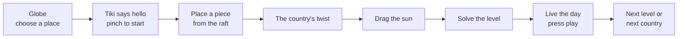

# Game design

## 1. The idea in one line

> Same sun, different skies. Let the sun in, keep the watchers out.

A spot is in direct sun when the sun can see it. A chair is private when the neighbour cannot see it. A table stays dry when the rain cannot reach it. All of these are the same question, *can this watcher reach this spot in a straight line?*, so the whole game runs on one rule. The sun is just a watcher very far away.

## 2. Pillars

1. **Hands first.** Every action is a ray pinch: aim, pinch, move, let go. Nothing needs fine finger poses, throwing or speed. Touch controllers work the same way, with the trigger for the pinch.
2. **Cause and effect you can see.** Every rule has a beam along the watcher's line and a label in words and a symbol. Moving anything updates them at once.
3. **One house, six skies.** The same courtyard puzzle plays out in six South-east Asian capitals, each with its own house, its own sun path and its own twist.
4. **Short and complete.** A level takes a minute or two; a country takes about five.

## 3. The session

| Beat | What happens |
|---|---|
| Globe | A small Earth turns to the place you pick; ASEAN members are tinted, the six playable capitals carry a marker |
| Hello | Tiki the gecko sits on the garden wall. Pinch Tiki to start |
| Place | An arrow points at the bamboo raft moored by the island. Pinch a piece, point at the courtyard, let go. The tutorial moves on by itself when a piece lands |
| Twist | Tiki introduces the place: the house, and what watches it here (the neighbour, boats, the high-rise, the typhoon, the rain) |
| Sun | Pinch the sun and drag it across the sky; the shadows move. The tutorial moves on when the sun moves |
| Goal | One short brief per level. Every rule shows pass or fail live |
| Solved | Tiki celebrates; stars for using few pieces. Press the bronze play button to live the day: the sun crosses the sky and every rule is checked hour by hour |

## 4. Countries and levels

Defined in [`src/sim/countries.ts`](../src/sim/countries.ts) and proven by [`scripts/prove2.ts`](../scripts/prove2.ts) (`npm run prove`): every level is solvable, none starts solved, and par is the fewest pieces that solve it.

| Country | Twist | Level | Brief | Par |
|---|---|---|---|---|
| Philippines · Manila | Typhoon wind over a 1.0 m bamboo fence | Kapitbahay | Block the neighbour's view of your reading chair | 1 |
| | | Umaga | Stay private; the plant needs the 8:30 sun from the east | 1 |
| | | Bagyo | Shelter the deck from the typhoon; keep the plant's morning sun | 1 |
| Thailand · Bangkok | Long-tail boats pass on the canal; the wall is only 0.9 m | Long-tail Boats | Keep the garden table out of the boats' sight | 1 |
| | | Lunch by the Water | Lunch in the shade, out of sight of the boats | 2 |
| | | A Day on the Water | A sunny swim the boats cannot see, a private chair, a shaded afternoon | 1 |
| Vietnam · Hanoi | Motorbikes stream down the lane; the laterite wall is only 1.1 m | Xe Máy | Keep the garden table out of the riders' sight | 1 |
| | | Hàng Xóm | Two watchers at once: the neighbour sees the chair, the riders see the table | 2 |
| | | Một Ngày Hà Nội | Sun on the lotus pond out of sight of the lane, a private chair, a shaded afternoon | 1 |
| Malaysia · Kuala Lumpur | Condo towers rise over the kampung and look straight down | Kampung Baru | Hide the garden table from the towers | 1 |
| | | Teh Tarik | Tea at lunch: in the shade and out of the towers' sight | 1 |
| | | Sehari Suntuk | A sunny swim the towers cannot see, a private chair, a shaded afternoon | 2 |
| Indonesia · Jakarta | Monsoon rain slants in from the west | Hujan | Keep the garden table dry in the 3:00 rain | 1 |
| | | Rain and Shine | A dry table in the rain; the plant still gets its morning sun | 1 |
| | | Musim Hujan | A dry deck, a private chair, shade in the afternoon | 1 |
| Singapore | The high-rise next door looks straight down | High-rise | Hide the pool from above | 1 |
| | | Morning Swim | Hidden from the block, but the pool still needs the 11:00 sun | 1 |
| | | The Whole Day | Morning plant, private swim, shaded lunch, an afternoon read | 3 |

Each country teaches a different piece: screens against a neighbour at eye level, hedges against boats looking over a low wall, a pergola against rain, a tree's canopy against a view from above.

**Stars.** Par or fewer pieces: 3 stars. One more: 2. Any other solution: 1. The level card on the desk shows three stars and "pieces · par" in the headset; best stars are kept in the browser.

**Players.** One. "Two watchers" names what looks at the house (the sun, and whoever looks in), not a second player.

## 5. Tiki, the guide

Tiki is an original house gecko (the name comes from *butiki*, Filipino for gecko). Geckos spend their day on courtyard walls moving between sun and shade, so Tiki knows where every shadow falls. Tiki sits on the garden wall, a glazed ceramic figure built in code, and:

- speaks one short line at a time on a card above its head;
- turns to look at what it is talking about, and an orange arrow points there too;
- blinks, breathes, sways its tail and hops when a level is solved;
- is pinched to start and to go to the next level, so the tutorial teaches the pinch.

The script is in [`src/tutorial.ts`](../src/tutorial.ts). It moves on when you act (a piece placed, the sun moved, the level solved), not only when you pinch Tiki.

## 6. Interactions

| Action | Gesture | Notes |
|---|---|---|
| Place a piece | Pinch a piece on the raft, point at the courtyard, let go | Snaps to the nearest free socket; a ghost ring shows where it will land |
| Move a placed piece | Pinch it and point somewhere else | |
| Turn a placed piece | Pinch it and let go without moving | Screens have 4 angles, hedges 2 |
| Put a piece back | Let go away from the courtyard | It floats back to the raft |
| Slide the overhang | Pinch its handle and pull | Only in levels that offer it |
| Move the sun | Pinch the sun and drag along its arc | Any hour of the day |
| Live the day | Pinch the bronze play button | Sun crosses the sky; every rule is checked hour by hour |
| Continue, next level | Pinch Tiki | |
| Choose a country | Pinch a place on the globe | |

All targets take a ray pinch, so the same build works with Quest hand tracking and with controllers. Details in [CONTROLS](CONTROLS.md).

## 7. Feedback

- **Beams:** a line from each watcher to its target, stopping with a marker on whatever blocks it. The neighbour's and the boats' beams are rust red; the sun's is warm gold.
- **Labels** over each target: SEEN or PRIVATE with an eye symbol; SUN or SHADE with the hour and a sun symbol; DRY or WET; SHELTERED or WINDY. Colour helps but is never the only cue.
- **Level card:** one line per rule with a check or a cross, the pieces used against par, and the line "Illustrative sunlight and visibility checks."
- **Sound:** a tick when a piece snaps, a chime per rule passed, a short phrase when the level is solved.

## 8. Simulation boundaries

The checks are explicit geometry: an unobstructed straight segment from the watcher to the target, against boxes. For the sun, the segment points along the sun's direction for that capital on 8 November at the hour the rule names. The checks are separate from the rendered lighting, and the art is built never to contradict them ([ART](ART.md)). We describe them only as *illustrative sunlight and visibility checks*: not certified daylight analysis, thermal comfort, wind or rain engineering, legal privacy compliance or structural validation.

## 9. Out of scope

General CAD editing, floor-plan generation, multiplayer, AI assistants, accounts, payments, a backend, continuous locomotion, complex physics, real weather simulation, and passthrough as decoration.

## 10. If time allows

- **Daily sun:** a challenge using the real sun path for today's date. `sunAt()` already takes the declination.
- **More of ASEAN:** the globe already shows all ten members; Vietnam and Malaysia are the next houses.
