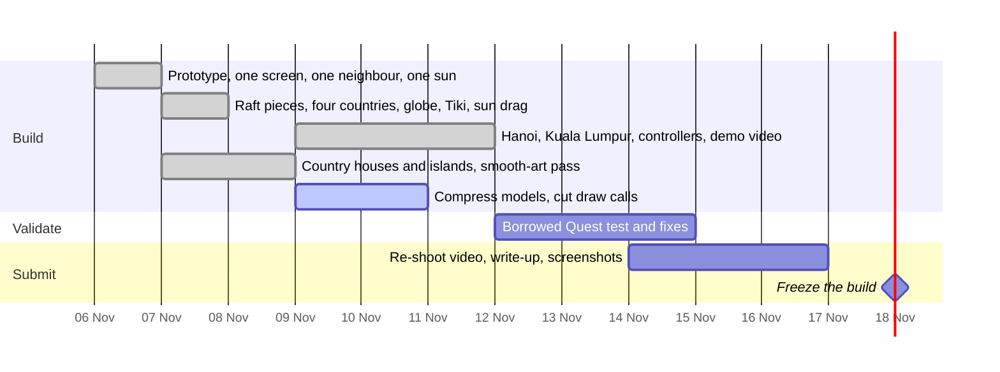

# Roadmap to 18 November 2026, 12:00 p.m. PT (19 Nov, 4:00 a.m. SGT)

Freeze the submitted build on the evening of 18 November (Singapore time).

## Done

**6 November.** Prototype: the courtyard house, a swinging screen, the neighbour and the sun; Tiki the gecko; solvability proof; hands-only playthrough in the emulator; live at valora-vr.vercel.app.

**11 November.** Tiki's words moved beside the level card in the headset, clear of the courtyard; the demo's headset shots re-recorded; docs brought up to six countries.

**9 November.** Vietnam (Hanoi: motorbikes in the lane) and Malaysia (Kuala Lumpur: condo towers) with their own houses, islands and three levels each, 18 levels proven solvable; stars and pieces against par on the level card in the headset; the 2:40 demo with voice-over, Touch controller footage, the competition entry card and the maker card.

**7 November.** Pieces carried from a bamboo raft by pointing (screen, hedge, tree, pergola); four countries with their own twists and real sun paths; 12 levels proven solvable; the globe country picker; drag the sun; live the day; stars; the seated recentre; the page overlay with a Continue button for computer players.

**8 November.**
- Country houses modelled in Blender: bahay kubo (Manila), ruen thai by the canal (Bangkok), joglo (Jakarta), black-and-white bungalow (Singapore), each with a local neighbour.
- Smooth storybook look on every island: round moss-capped rocks, a soft grass lip, gradient colours, smooth shading, new palms ([ART](ART.md)).
- Trailer and showcase re-shot on the new art ([VIDEO](VIDEO.md)); nine social graphics ([SOCIAL](SOCIAL.md)).
- Docs brought up to date.

## Next

1. **Performance:** compress models (meshopt or Draco, KTX2), fewer island triangles, merged scenery ([PERFORMANCE](PERFORMANCE.md)).
2. **Quest test (about 12 November):** the [checklist](QUEST-TEST-CHECKLIST.md); fix what it finds.
3. **Video:** add a real Quest clip once the headset test is done.
4. **Submission:** final text ([SUBMISSION](SUBMISSION.md)), screenshots, the eligibility questions in [COMPETITION](COMPETITION.md).

## Open decisions

- The VaLora name story mentions a real person (the designer's wife). The rules limit identifiable persons other than entrants, so decide whether the entry materials keep it.
- Division (New Experience) to confirm with the organisers.
