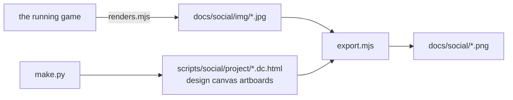

# Social media graphics

Ten ready-to-post images in [`docs/social/`](social/), made from real renders of the game. Editable versions live on the "VaLora social media graphics" design canvas in Claude, where any wording can be retyped.

| File | Size | Use |
|---|---|---|
| `valora-main-1080x1080.png` | 1080×1080 | Square launch post: the Bangkok island, "Same sun. Different skies." |
| `valora-islands-1080x1350.png` | 1080×1350 | Four of the islands and each country's watcher (made before Hanoi and Kuala Lumpur) |
| `valora-howitplays-1080x1350.png` | 1080×1350 | Choose a place, place pieces, drag the sun, live the day |
| `valora-country-ph/th/id/sg-1080x1350.png` | 1080×1350 | Carousel: one slide per country with its house, watcher and levels |
| `valora-story-1080x1920.png` | 1080×1920 | Story or Reel cover with the link |
| `valora-landscape-1200x675.png` | 1200×675 | LinkedIn and X: Manila, six capitals |
| `valora-entry-1600x900.png` | 1600×900 | The competition entry: "Let the sun in. Keep the watchers out.", the six islands as a mosaic with each watcher, 18 levels, hands or Touch controllers, the play link and the YouTube demo. For X, LinkedIn, YouTube community posts and the Devpost gallery |

| Instagram carousel order | |
|---|---|
| 1 | `valora-islands` |
| 2–5 | `valora-country-ph`, `-th`, `-id`, `-sg` |
| 6 | `valora-howitplays` |

## Look

The VaLora brand ([BRAND](BRAND.md)): Cormorant Garamond titles, Inter text, warm paper `#faf8f3`, ink `#1d1d1f`, bronze labels. No gradients over the pictures: text sits on paper panels so it stays readable at any size.

## How they are made



```bash
npm run dev                                   # the game, for the renders
node scripts/social/renders.mjs               # stills: each island solved, no tutorial arrow
python3 scripts/social/make.py                # artboards (layout and copy live here)
node scripts/social/export.mjs                # PNGs at their real sizes
```

`export.mjs` needs the Cormorant Garamond font files (`npm pack @fontsource/cormorant-garamond`, unpack, set `CORMORANT_DIR` to its `files/` folder) and Inter installed. To change wording, edit `make.py` (or retype it on the design canvas) and run the last two steps.
