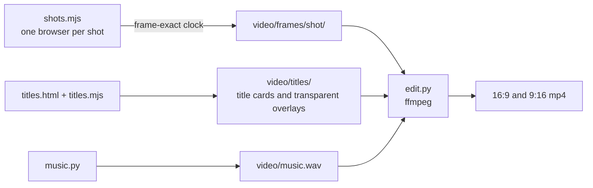

# Video

Three cuts, each in 16:9 and 9:16 (Reels, TikTok, Shorts):

| Cut | Length | File |
|---|---|---|
| **Demo for the submission:** the trailer, the entry and the goal, choosing a place, then the game in the headset view with hands and with Touch controllers, how to score, all six capitals, the maker | 2:40 | `video/valora-demo-16x9.mp4`, `video/valora-demo-9x16.mp4` |
| Trailer | about 26 s | `video/valora-trailer-16x9.mp4`, `video/valora-trailer-9x16.mp4` |
| Showcase: the trailer, then the features | about 61 s | `video/valora-showcase-16x9.mp4`, `video/valora-showcase-9x16.mp4` |

All footage is the real game, rendered frame by frame. Headset footage comes from Meta's IWER emulator and is labelled "Emulator" on screen; nothing is presented as recorded on a Quest until it is. `video/` is ignored by git (frames and cuts are large); the scripts that make it are committed. Share the finished cuts as files or attach them to a GitHub release.

> **8 November:** every shot re-captured on the smooth-art islands and the new Bangkok house; trailer shots hide the tutorial arrow (`VR.chrome(false)`); feature captions sit above Tiki's card (`hi=1` in `make-titles.sh`). Integrated loudness −13.3 LUFS.

## The demo cut (CUT=demo)

The submission is for a VR competition, so after the trailer and two cards everything is the headset view: a seated player at the desk, pointing and pinching, filmed in Meta's IWER emulator and labelled so on every shot. Choosing a place happens on the page before entering VR, and that shot is labelled "Browser view". Replace or add a real Quest recording once the headset test is done. Total 2:40, inside the 3-minute limit.

| Time | Shot | What it shows |
|---|---|---|
| 0:00 | Trailer | Same sun, six capitals (Manila, Bangkok, Hanoi, Kuala Lumpur, Jakarta, Singapore), the watchers, the logo |
| 0:27 | `titles/entry` | Our entry for the Meta VR Start Developer Competition 2026 |
| 0:31 | `titles/goal` | Let the sun in, keep the watchers out. One player; the two watchers are the sun and whoever looks in |
| 0:36 | `d_globe` | Browser view: hover Vietnam and Malaysia (the globe turns), pick the Philippines, point at Enter XR |
| 0:45 | "Now, in the headset." | Seated · hands or Touch controllers · no walking |
| 0:48 | `v_ph` | Pinch Tiki; carry a screen from the raft to the courtyard; turn it |
| 1:04 | `v_look` | Look around the Bangkok island: the neighbour, the boats, the sun |
| 1:11 | `v_sun` | Pinch the sun and drag it from morning to late afternoon |
| 1:21 | `v_score` | How to score, Hanoi level 2 (two watchers at once): lean in to read the card (rules NOT YET), a screen for the neighbour, a hedge for the riders, lean in again (both DONE, three stars, two pieces against par two), press play and live the day |
| 1:48 | `v_vn` | Touch controllers (`INPUT=controller`): Hanoi, a hedge hides the table from the motorbikes |
| 1:56 | `v_th`, `v_my`, `v_id`, `v_sg` | Bangkok: a hedge against the boats; Kuala Lumpur: a tree against the condo towers; Jakarta: a pergola against the rain; Singapore: a tree against the high-rise |
| 2:27 | Proof card | 18 levels, 6 capitals, every level proven solvable |
| 2:31 | `titles/profile` | Made by Aljabri Alam · Technical Lead · Singapore · github.com/aljabrialam |
| 2:36 | End card | The link |

`v_th2` (Lunch by the Water, two screens) is scripted but not in the cut: its second pinch picks up the first screen again. `v_day` is no longer in the cut either: `v_score` ends by pressing play.

Headset shots: `node scripts/video/vrshots.mjs <shot>` (`TEST=1` for a quick quarter-size check, `INPUT=controller` for Touch controllers). The emulated hand or controller is placed by its pointing ray through the emulator's remote control (the same calls as `iwsdk xr`), held under programmatic control each frame; the head stays still while the hand works, because the emulated hand moves with the head. Hand and controller models come from the webxr-input-profiles package served locally (`PROFILES_DIR`), since the capture sandbox cannot reach its CDN. The player leans in 14 cm (`VR.lean`) so pieces read at video size, and further (`CARD_LEAN`) to read the level card.

### Voice-over

A narrator states the objective in the trailer, says it is single-player, says it is our competition entry, ("Your goal: let the sun in, and keep the watchers out") and then talks through each control as the hand performs it: pinch Tiki, carry a screen from the raft, turn it, drag the sun, press play, then one twist per city. The words match the on-screen captions, so the cut also works muted. The script and its timings are in `scripts/video/vo.py`. Each line starts at a fixed second, and the script fails if a line would run into the next one.

- **Voice:** Kokoro v1.0 (open weights, Apache-2.0), voice `af_heart`, run locally. No account or online service is used. Change it with `VO_VOICE`, for example `bf_emma` or `am_michael`.
- **Mix:** the music ducks under the voice by sidechain compression, and the whole mix is normalised to −14 LUFS. The voice sits about 15 dB above the music, and at least 9 dB in the loudest moments. `MUSIC_LEVEL` sets the music bed (default 0.36).
- **Earlier cut:** the 1:40 demo (four capitals) with the voice-over is kept as `video/valora-demo-100s-*.mp4`, and without it as `video/valora-demo-novo-*.mp4`.

The voice is synthetic. If the entry form asks about AI-generated content, declare it there. To use a human voice, record the same lines at the same start times and pass that file as `VO`.

```bash
bash scripts/video/make-titles.sh && bash scripts/video/make-demo-titles.sh
MUSIC_DUR=159.55 python3 scripts/video/music.py video/music-demo.wav
for s in t_vn t_my d_globe; do node scripts/video/shots.mjs $s; done
for s in v_ph v_look v_sun v_th v_my v_id v_sg; do node scripts/video/vrshots.mjs $s; done
VW=1280 VH=720 node scripts/video/vrshots.mjs v_score
INPUT=controller node scripts/video/vrshots.mjs v_vn
KOKORO_DIR=/path/to/kokoro python3 scripts/video/vo.py        # -> video/vo-demo.wav
CUT=demo MUSIC=video/music-demo.wav VO=video/vo-demo.wav python3 scripts/video/edit.py
```

## Shot list (trailer and showcase)

| Part | Shot | What it shows |
|---|---|---|
| Trailer | `titles/same` | "Same sun." |
| | `t_ph` | Manila: a slow push across the kubo island, place name over it |
| | `titles/skies` | "Different skies." Manila · Bangkok · Hanoi · Kuala Lumpur · Jakarta · Singapore |
| | `t_th`, `t_vn`, `t_my`, `t_id`, `t_sg` | Bangkok, Hanoi, Kuala Lumpur, Jakarta, Singapore |
| | `titles/watch` | "Someone is always watching." |
| | `t_watch` | Over the neighbour's shoulder: the red line of sight lands on the reading chair |
| | `titles/logo` | VaLora: Two Watchers. A seated VR puzzle about sun, shade and privacy |
| Features | `w_globe` | Choose a place: the globe turns to it |
| | `w_tiki` | Tiki says hello |
| | `w_place` | Place a piece from the raft; the beam stops on it |
| | `w_sun` | Drag the sun; the shadows move |
| | `w_day` | Live the day |
| | `w_ph3`, `w_th1`, `w_id1`, `w_sg1` | Each country's twist: typhoon, boats, rain, high-rise |
| | `w_vr` | The headset view in the emulator with a hand placing a piece (labelled Emulator) |
| | `titles/end` | "Play it now", the link, 18 levels · 6 countries, seated, point and pinch or pull the trigger, "Illustrative sunlight and visibility checks." |

## How it is made



- **Frame-exact capture** (`scripts/video/clock.mjs`): the page's clock is replaced (`performance.now`, `Date.now`, `requestAnimationFrame`), and each frame is advanced by exactly 1/24 s with `window.__frame(dt)` before a screenshot over the Chrome DevTools Protocol. Software rendering without a GPU is slow (about 1.6 s a frame at 960x540), so the motion stays smooth whatever the render speed.
- **Camera:** `VR.cinema({pos, look, fov})` holds a fixed or moving camera; `VR.chrome(false)` hides the page overlays.
- **Headset shot:** enters XR in the emulator, hides the emulator's panels, recentres, and drives the emulated right hand through `IWER_DEVICE`.
- **Titles and overlays** are HTML pages driven by the same clock, captured with a transparent background.
- **Music** is synthesised in numpy (no samples), mixed to −14 LUFS.
- **9:16** puts the 16:9 picture over a blurred fill of itself, with the titles re-framed.

## Commands

Needs the dev server running (`npm run dev`).

```bash
scripts/video/run-all.sh                                # every shot (SHOTS="t_th w_th1" for some)
VW=960 VH=540 SHOTS="w_place" scripts/video/run-all.sh  # smaller frames for long shots
PREVIEW=1 node scripts/video/shots.mjs t_th             # one frame, to check framing
scripts/video/make-titles.sh                            # title cards and overlays
python3 scripts/video/music.py video/music.wav
CUT=trailer python3 scripts/video/edit.py               # trailer only
python3 scripts/video/edit.py                           # showcase
```

The submission rules ask for a video under 3 minutes; judges may stop at 3:00, so the strongest material comes first.
