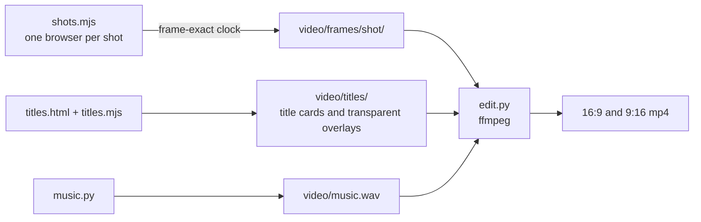

# Video

Two cuts, each in 16:9 (YouTube, the submission) and 9:16 (Reels, TikTok, Shorts):

| Cut | Length | File |
|---|---|---|
| Trailer | about 26 s | `video/valora-trailer-16x9.mp4`, `video/valora-trailer-9x16.mp4` |
| Showcase: the trailer, then the features | about 61 s | `video/valora-showcase-16x9.mp4`, `video/valora-showcase-9x16.mp4` |

All footage is the real game, rendered frame by frame. Headset footage comes from Meta's IWER emulator and is labelled "Emulator" on screen; nothing is presented as recorded on a Quest until it is. `video/` is not committed (large files); the scripts that make it are.

> **8 November:** the footage was captured before the smooth-art pass and the new Bangkok house. Re-shoot before using the cuts: `scripts/video/run-all.sh` (all shots), then `make-titles.sh` only if the words changed, then `edit.py`.

## Shot list

| Part | Shot | What it shows |
|---|---|---|
| Trailer | `titles/same` | "Same sun." |
| | `t_ph` | Manila: a slow push across the kubo island, place name over it |
| | `titles/skies` | "Different skies." Manila · Bangkok · Jakarta · Singapore |
| | `t_th`, `t_id`, `t_sg` | Bangkok, Jakarta, Singapore |
| | `titles/watch` | "Someone is always watching." |
| | `t_watch` | Over the neighbour's shoulder: the red line of sight lands on the reading chair |
| | `titles/logo` | VaLora: Two Watchers. A seated VR puzzle about sun, shade and privacy |
| Features | `w_globe` | Choose a place: the globe turns to it |
| | `w_tiki` | Tiki says hello |
| | `w_place` | Place a piece from the raft; the beam stops on it |
| | `w_sun` | Drag the sun; the shadows move |
| | `w_day` | Live the day |
| | `w_ph3`, `w_th1`, `w_id1`, `w_sg1` | Each country's twist: typhoon, boats, rain, high-rise |
| | `w_vr` | The headset view in the emulator with a hand placing a piece (labelled Emulator) |
| | `titles/end` | "Play it now", the link, 12 levels · 4 countries, seated and hands only, "Illustrative sunlight and visibility checks." |

## How it is made



- **Frame-exact capture** (`scripts/video/clock.mjs`): the page's clock is replaced (`performance.now`, `Date.now`, `requestAnimationFrame`), and each frame is advanced by exactly 1/24 s with `window.__frame(dt)` before a screenshot over the Chrome DevTools Protocol. Software rendering without a GPU is slow (about 1.6 s a frame at 960x540), so the motion stays smooth whatever the render speed.
- **Camera:** `VR.cinema({pos, look, fov})` holds a fixed or moving camera; `VR.chrome(false)` hides the page overlays.
- **Headset shot:** enters XR in the emulator, hides the emulator's panels, recentres, and drives the emulated right hand through `IWER_DEVICE`.
- **Titles and overlays** are HTML pages driven by the same clock, captured with a transparent background.
- **Music** is synthesised in numpy (no samples), mixed to −14 LUFS.
- **9:16** puts the 16:9 picture over a blurred fill of itself, with the titles re-framed.

## Commands

Needs the dev server running (`npm run dev`).

```bash
scripts/video/run-all.sh                                # every shot (SHOTS="t_th w_th1" for some)
VW=960 VH=540 SHOTS="w_place" scripts/video/run-all.sh  # smaller frames for long shots
PREVIEW=1 node scripts/video/shots.mjs t_th             # one frame, to check framing
scripts/video/make-titles.sh                            # title cards and overlays
python3 scripts/video/music.py video/music.wav
CUT=trailer python3 scripts/video/edit.py               # trailer only
python3 scripts/video/edit.py                           # showcase
```

The submission rules ask for a video under 3 minutes; judges may stop at 3:00, so the strongest material comes first.
